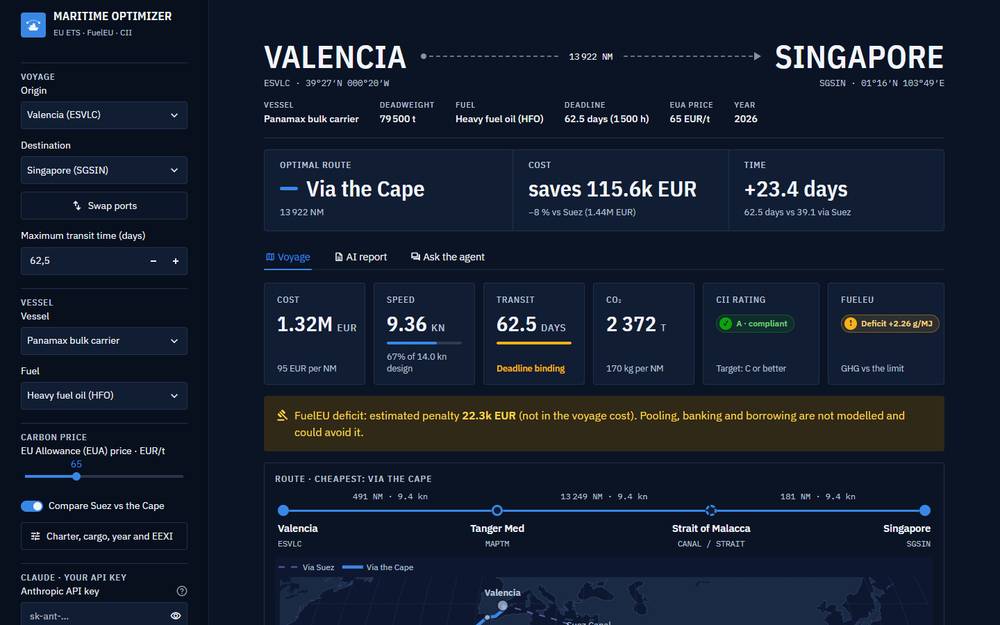

# maritime-optimizer

**Optimización de ruta, velocidad y combustible para buques bajo el EU ETS, FuelEU Maritime y MARPOL Anexo VI (CII/EEXI), con reporte de emisiones según ISO 14083.**

*[Read in English](README.md)*

Desde 2024 las emisiones del transporte marítimo tienen precio en Europa. Cada decisión sobre **la ruta**, **la velocidad** y **el combustible** lleva asociado un coste de carbono, un límite de intensidad y una calificación de eficiencia. `maritime-optimizer` convierte ese marco regulatorio en un problema de optimización y lo resuelve:

- busca la **ruta factible más barata** sobre un grafo marítimo global (puertos, canales, estrechos y puntos de paso en mar abierto, con detección de cruce de tierra sobre la cartografía de Natural Earth);
- calcula la **velocidad óptima** de forma analítica, incluido el óptimo exacto cuando hay un plazo de llegada;
- calcula el coste de los **derechos del EU ETS** con la regla geográfica intra/extra-UE, el CH₄ y el N₂O, el escape de metano, el zero-rating de biocombustibles y la deducción por clase de hielo;
- comprueba el **CII** (banda A-E, con reintento automático limitando la velocidad si el viaje queda por debajo de C) y la intensidad well-to-wake de **FuelEU Maritime**;
- informa de la intensidad de emisiones **ISO 14083** (gCO₂e por tonelada-km);
- compara **combustibles**, **precios del carbono** y **corredores** (Suez frente al Cabo de Buena Esperanza).

Cada valor regulatorio está en un CSV que cita su fuente legal. Así el modelo se puede auditar y actualizar sin tocar el código.

## Instalación

```bash
git clone https://github.com/alejandrovinuesa/maritime-optimizer.git
cd maritime-optimizer
pip install -e .
maritime-opt doctor        # descarga la cartografía de Natural Earth (~1 MB) y prueba un viaje
```

Requiere Python 3.10 o superior.

## Uso rápido

```bash
maritime-opt route ESVLC NLRTM --vessel panamax_bulker --eua 90
maritime-opt route SGSIN NLRTM --vessel lr2_lng_tanker --tmax 1500 --avoid SUEZ
maritime-opt scenario E3          # comparativa HFO / MGO / LNG / BioLNG
```

[](https://maritime-optimizer.streamlit.app/?origin=ESVLC&destination=SGSIN&compare=1)

**[Abrir la aplicación en línea](https://maritime-optimizer.streamlit.app)**

Con `--json` la salida se obtiene en formato JSON. `maritime-opt dashboard all` genera los cinco paneles HTML y `streamlit run app/streamlit_app.py` abre la aplicación interactiva: eliges dos puertos, el tiempo máximo y un buque y obtienes el viaje optimizado sobre un mapa. Con tu propia clave de Anthropic (`pip install -e ".[app,agents]"`) se activan el informe con IA y un chat con el agente; la clave solo vive en la sesión del navegador y una clave del servidor se ignora salvo que se active `MARITIME_OPT_ALLOW_SERVER_KEY=1`. Un escenario se puede compartir como enlace (`?origin=ESVLC&destination=SGSIN&compare=1`) y la app se puede desplegar gratis en Streamlit Community Cloud ([instrucciones](README.md#interactive-app)). El uso desde Python se describe en el [README en inglés](README.md#quick-start).

## Agentes (Claude)

`pip install -e ".[agents]"` añade un servidor MCP (`maritime-opt-mcp`) para usar el optimizador desde Claude Desktop o Claude Code, un asistente en lenguaje natural (`maritime-opt ask "..."`), un generador de informes de cumplimiento (`maritime-opt report E3`) y un revisor de cambios normativos (`maritime-opt regulatory-update texto.txt`). Las cifras siempre las calcula el optimizador; Claude solo elige herramientas y redacta. El proyecto no incluye ninguna clave de API: cada usuario usa la suya (`ANTHROPIC_API_KEY`) y paga su propio consumo; el resto del paquete no llama a ningún modelo. El revisor normativo propone cambios con cita literal, el código los valida y nunca modifica los CSV: genera un diff para revisión humana.

## El modelo

Se minimiza el coste del viaje $Z = C_\text{fuel} + C_\text{ETS}\,\beta_\text{hielo} + C_\text{TCE} + C_\text{peajes}$ sobre la ruta, la velocidad y el combustible. Las restricciones son el EEXI (velocidad máxima), el CII (banda C o mejor), FuelEU Maritime (se verifica y se informa del déficit) y el tiempo máximo de tránsito.

El coste por milla es $c(v) = \alpha v^2 + \beta / v$. El primer término recoge combustible y ETS. El segundo recoge el coste de oportunidad del tiempo, con $\beta = \text{TCE}/24$. Es una función convexa y su mínimo es

$$v^* = \left(\frac{\beta}{2\alpha}\right)^{1/3}$$

Si el plazo de llegada es restrictivo, el óptimo es una velocidad uniforme que agota ese plazo. La multa de FuelEU (Anexo IV) puede incluirse en Z, y el paquete calcula también el CII anual por buque, el pooling de FuelEU entre buques y rutas con factores de resistencia por tramo (meteorología). La búsqueda áurea de la memoria original se conserva como `speed_method="golden"`.

## Datos y aviso legal

**Valores regulatorios**, tomados de las normas citadas en su versión vigente en 2026: Reglamento Delegado (UE) 2023/2776, Reglamento (UE) 2023/1805 (FuelEU Maritime), Directiva 2003/87/CE modificada por la Directiva (UE) 2023/959, resoluciones MEPC.338(76), MEPC.353(78) y MEPC.354(78) de la OMI y MARPOL Anexo VI. La ISO 14083:2023 se cita, pero no se distribuye.

**Valores estimados o ilustrativos**, que son supuestos del autor y no datos oficiales:

- la flota de ejemplo es **genérica**: los parámetros son típicos de cada segmento y no describen ningún buque real;
- el MCR se obtiene con la fórmula del Almirantazgo y el SFOC con rangos de catálogo de fabricante;
- el TCE, los precios de combustible y el precio del EUA son valores ilustrativos de 2026, **no cotizaciones**;
- los peajes de Suez y Panamá son valores representativos por tránsito;
- las distancias son ortodrómicas × 1,15 y se supone mar en calma.

> Herramienta de investigación y apoyo a la decisión. Los parámetros regulatorios pueden cambiar después de 2026. Los parámetros técnicos y económicos son estimaciones ilustrativas. Los resultados no sustituyen la verificación oficial MRV, FuelEU ni CII, ni constituyen asesoramiento legal o comercial.

## Origen

Este proyecto nace del Trabajo de Fin de Grado *«Estrategia de optimización de las emisiones de CO₂ en cumplimiento de la regulación para una naviera»* (Universidad Carlos III de Madrid, 2026). Para citarlo, ver [`CITATION.cff`](CITATION.cff).

## Licencia

[MIT](LICENSE).
