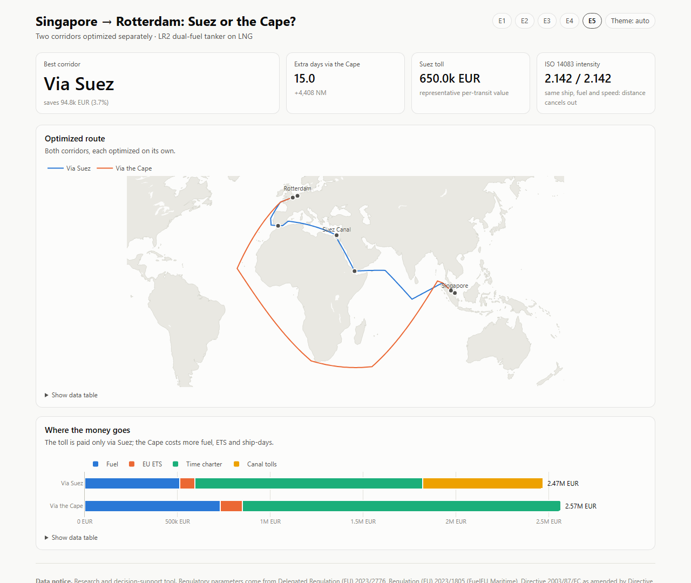
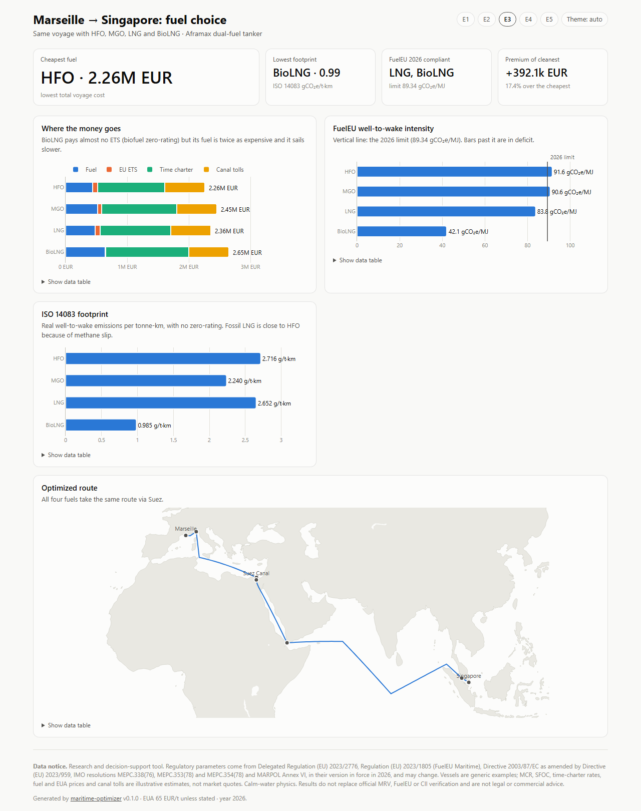
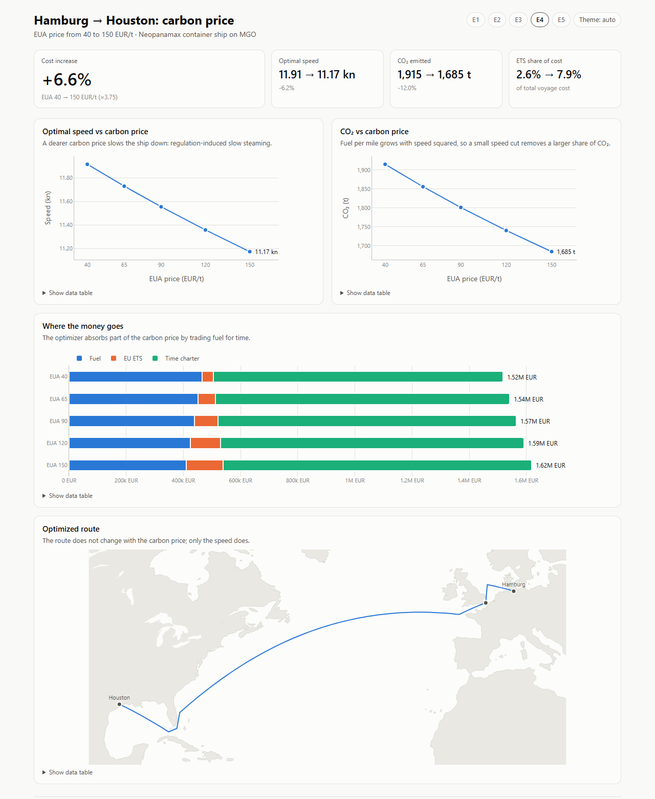

# maritime-optimizer

**Regulation-aware route, speed and fuel optimization for ships under the EU ETS, FuelEU Maritime and MARPOL Annex VI (CII/EEXI), with ISO 14083 emissions reporting.**

[](https://github.com/alexvinuesa22-debug/maritime-optimizer/actions/workflows/ci.yml)


*[Leer en español](README.es.md)*

Since 2024 shipping emissions have a price in Europe. Every decision about **which route**, **how fast** and **which fuel** now carries a carbon cost, a fuel-intensity limit and an efficiency rating. `maritime-optimizer` turns that regulatory framework into an optimization problem and solves it:

- finds the **cheapest feasible route** on a global maritime graph (ports, canals, straits and open-sea waypoints, with land-crossing detection on Natural Earth cartography);
- computes the **optimal speed** in closed form, including the exact optimum when a contractual arrival time binds;
- prices **EU ETS allowances** with the intra/extra-EU geographic rule, CH₄ and N₂O, methane slip, biofuel zero-rating and the ice-class deduction;
- checks **CII** (rating A–E, with an automatic speed-cap retry if the voyage falls below C) and **FuelEU Maritime** well-to-wake intensity, and can price the FuelEU deficit into the optimum (Annex IV penalty);
- aggregates voyages into the regulatory units: **annual CII per ship** and **FuelEU pooling** across a fleet;
- accepts **per-leg added-resistance factors** (e.g. from a weather forecast) and re-optimizes route and speeds;
- plugs into **Claude**: an MCP server, a plain-language assistant, a report writer and a regulatory-update reviewer;
- reports the **ISO 14083** emissions intensity (gCO₂e per tonne-km) of the solution;
- compares **fuels**, **carbon prices** and **corridors** (Suez vs Cape of Good Hope) side by side.

Every regulatory number lives in a CSV that cites its legal source, so the model can be audited, and updated, without touching code.

[](https://alexvinuesa22-debug.github.io/maritime-optimizer/e5.html)

**Live dashboards:** [E1](https://alexvinuesa22-debug.github.io/maritime-optimizer/e1.html) · [E2](https://alexvinuesa22-debug.github.io/maritime-optimizer/e2.html) · [E3](https://alexvinuesa22-debug.github.io/maritime-optimizer/e3.html) · [E4](https://alexvinuesa22-debug.github.io/maritime-optimizer/e4.html) · [E5](https://alexvinuesa22-debug.github.io/maritime-optimizer/e5.html)

## Install

```bash
git clone https://github.com/alexvinuesa22-debug/maritime-optimizer.git
cd maritime-optimizer
pip install -e .
maritime-opt doctor        # downloads Natural Earth land polygons (~1 MB) and runs a test voyage
```

Requires Python 3.10+. Dependencies: `networkx`, `geopandas`, `shapely`.

## Quick start

**Command line**

```bash
maritime-opt route ESVLC NLRTM --vessel panamax_bulker --eua 90
maritime-opt route SGSIN NLRTM --vessel lr2_lng_tanker --tmax 1500 --avoid SUEZ
maritime-opt scenario E3          # fuel comparison HFO / MGO / LNG / BioLNG
maritime-opt vessels              # example fleet
maritime-opt ports                # available ports
```

Add `--json` to any `route` or `scenario` command for machine-readable output.

**Python**

```python
from maritime_optimizer import MaritimeGraph, load_vessels_from_csv, optimize_voyage
from maritime_optimizer.scenarios import build_request

graph = MaritimeGraph()
vessel = load_vessels_from_csv()["panamax_bulker"]
result = optimize_voyage(graph, build_request(
    vessel, origin_port="ESVLC", destination_port="NLRTM", eua_price=90))

print(result.route_ports, result.legs[0].speed_knots, result.total_cost_eur)
print(result.cii_rating, result.fueleu_compliant, result.iso14083_intensity)
```

See [`examples/quickstart.py`](examples/quickstart.py).

## Dashboards

```bash
pip install -e ".[viz]"
maritime-opt dashboard all --out dashboards     # five self-contained HTML pages + index.html

pip install -e ".[app]"
streamlit run app/streamlit_app.py             # interactive app: any vessel, ports, fuel, EUA price
```

Each HTML dashboard has KPI tiles (cost, speed, CO₂, CII rating, FuelEU status, ISO 14083 intensity), the route map, the cost breakdown and scenario-specific charts. Every chart has hover tooltips and a data table, light and dark mode follow the system setting, and the data notice is printed in the footer. Pre-built copies live in [`examples/dashboards/`](examples/dashboards/) and are published on GitHub Pages by [`pages.yml`](.github/workflows/pages.yml).

| | |
|---|---|
| [](https://alexvinuesa22-debug.github.io/maritime-optimizer/e3.html) **E3** fuel choice | [](https://alexvinuesa22-debug.github.io/maritime-optimizer/e4.html) **E4** carbon price |

## Agents (Claude)

The optimizer is deterministic; the agents sit on top of it and never produce a number themselves.

```bash
pip install -e ".[agents]"          # anthropic, mcp; credentials from ANTHROPIC_API_KEY or `ant auth login`
```

**MCP server.** Exposes the optimizer to Claude Desktop, Claude Code or any MCP client as six read-only tools (`list_ports`, `list_vessels`, `optimize_route`, `compare_fuels`, `compare_corridors`, `eua_sensitivity`). It makes no model calls.

```bash
claude mcp add maritime-optimizer -- maritime-opt-mcp        # Claude Code
```

```json
{ "mcpServers": { "maritime-optimizer": { "command": "maritime-opt-mcp" } } }
```

**Ask in plain language.** Claude picks the tools, the optimizer computes, Claude explains:

```bash
maritime-opt ask "Suez or the Cape for the LR2 tanker from Singapore to Rotterdam if the EUA hits 120 EUR/t?" -v
```

**Compliance report.** Figures, charts and tables come from the optimizer; Claude writes the summary, findings, regulatory status and recommendations as structured output. Any figure in the narrative that does not match the optimizer output is flagged in the report.

```bash
maritime-opt report E3 --out e3_report.html
```

Example: [the E5 report (Suez vs Cape)](https://alexvinuesa22-debug.github.io/maritime-optimizer/reports/e5_report.html), generated once by the maintainer and kept in [`examples/reports/`](examples/reports/e5_report.html), so you can see the output without an API key.

**Regulatory update.** Claude reads a new legal text next to the regulatory CSVs and proposes cell changes, each with the article and a verbatim quote. The code checks every proposal (table and row exist, the current value matches, the quote is in the source) and writes `proposal.md` plus a `proposal.diff` of the changes that pass. It never edits the CSVs: a person reviews and runs `git apply`.

```bash
maritime-opt regulatory-update amendment.txt --out-dir proposal/
```

The agents use `claude-opus-5-5` with server-side refusal fallbacks enabled (`fallbacks="default"`), so a declined request is retried on a fallback model inside the same call. **Bring your own key.** The project ships no API key and never calls Claude on anyone's behalf: `ask`, `report` and `regulatory-update` use the credentials of whoever runs them and are billed to that account. Everything else (optimizer, CLI, MCP server, dashboards, Streamlit app, tests) makes no model calls and costs nothing.

## The model

The tool minimizes the voyage cost

$$
\min Z = C_\text{fuel} + C_\text{ETS}\,\beta_\text{ice} + C_\text{TCE} + C_\text{tolls}
$$

over the route $R$, the speed $v$ and the fuel $f$, subject to:

| Constraint | Source | How it is applied |
|---|---|---|
| EU ETS geographic coverage (100 % intra-EU, 50 % extra-EU) | Directive 2003/87/EC as amended by Directive (EU) 2023/959 | Cost factor α_geo |
| Maximum speed (EEXI / engine power limitation) | MARPOL Annex VI, reg. 23 | Speed cap `epl_max_speed_knots` (CLI `--epl-max-speed`; `Vessel.epl_speed_knots(f)` converts an EPL power fraction); reported as binding or not. Without an EPL, the design speed |
| Operational carbon intensity, rating ≥ C | MARPOL Annex VI, reg. 28; MEPC.338(76), .353(78), .354(78) | Post-optimization check; retries with v_max × 0.9 / 0.8 / 0.7 |
| Well-to-wake GHG intensity limit | Regulation (EU) 2023/1805 (FuelEU Maritime), art. 4 and Annex IV | Checked and reported; optionally priced into Z as the Annex IV penalty (`include_fueleu_penalty=True`) |
| Maximum transit time | Commercial contract | Hard constraint |

**Why there is an optimal speed.** Fuel and carbon costs per mile grow with $v^2$ (cubic propeller law), while the time-charter cost per mile falls with $1/v$. The cost per mile $c(v) = \alpha v^2 + \beta / v$ is convex, with minimum

$$
v^* = \left(\frac{\beta}{2\alpha}\right)^{1/3}, \qquad \beta = \frac{\text{TCE}}{24}
$$

clipped to the vessel's speed range. When the arrival deadline binds, the optimum is a **uniform** speed $v = D / (T_\max - t_\text{canals})$ (KKT conditions). The golden-section search used in the original thesis is kept as `speed_method="golden"`.

**Routing.** A* over a directed graph of 23 ports, 10 canals and straits, and 59 open-sea waypoints (532 directed edges), with an admissible great-circle heuristic; Yen's k-shortest paths take over only when the cheapest route misses the deadline or the CII. Canal tolls are charged once, on the edge entering the canal. An edge exists only if its **great-circle arc** (the path its distance measures) crosses at most 5.4 NM of mapped land outside a 0.7° trim around each end, and never a shallow-water no-go area (Bahama Banks, Florida Keys). The graph is built once and cached on disk.

**FuelEU penalty, pooling and annual CII.** The Annex IV penalty is proportional to fuel burned, so pricing it simply raises α and the closed-form speed still holds. Across voyages:

```python
from maritime_optimizer import annual_cii, fueleu_pool

annual_cii(vessel, voyages_of_the_year, 2026)   # attained/required CII and rating for the ship
pool = fueleu_pool(voyages_of_the_fleet, 2026)  # per-ship balances, pool validity, penalty saved
```

**Weather.** `OptimizationRequest(edge_resistance={("WP_REDS", "GBE"): 1.3, ...})` multiplies the calm-water consumption of those legs. Each leg then gets its own closed-form speed $v_e^* = (\beta / 2\alpha w_e)^{1/3}$, and under a binding deadline the KKT conditions are solved by bisection. Connecting a forecast source is left to the caller.

## Architecture

| Module | Responsibility |
|---|---|
| `config.py` | Loads the regulatory CSVs into typed structures |
| `models.py` | Dataclasses: `Vessel`, `Port`, `OptimizationRequest`, `LegResult`, `VoyageResult` |
| `routing.py` | Great-circle distances, land-crossing detection, canals and waypoints |
| `graph.py` | `MaritimeGraph` (networkx), EU ETS voyage classification, disk cache |
| `emissions.py` | Fuel, MRV emissions, ETS cost, CII, FuelEU and ISO 14083 formulas |
| `optimizer.py` | Analytic speed, A* and Yen routing, T_max handling, CII retry, comparisons |
| `compliance.py` | Annual CII per ship, FuelEU compliance balance and pooling |
| `scenarios.py` | The five demonstration scenarios |
| `reporting.py` | Text reports and comparison tables |
| `cli.py` | `maritime-opt` command line |
| `viz/` | Plotly figures, HTML dashboards, colour theme (optional `viz` extra) |
| `agents/` | Shared deterministic tools, MCP server, assistant, report and regulatory agents (optional `agents` extra) |

Regulatory data: [`src/maritime_optimizer/data/regulatory/`](src/maritime_optimizer/data/regulatory/README.md), one CSV per legal source.

## Demonstration scenarios

| ID | Voyage | What it shows |
|---|---|---|
| E1 | Valencia → Rotterdam, bulk carrier | Intra-EU voyage, 100 % ETS; slow steaming; FuelEU deficit with HFO |
| E2 | Rotterdam → New York, container ship | Extra-EU voyage, 50 % ETS; a high TCE pushes the optimal speed up |
| E3 | Marseille → Singapore, LNG tanker | HFO vs MGO vs LNG vs BioLNG: cost, FuelEU compliance and ISO 14083 intensity |
| E4 | Hamburg → Houston, container ship | Carbon-price sensitivity, EUA 40–150 EUR/t |
| E5 | Singapore → Rotterdam, LR2 tanker | Suez Canal vs Cape of Good Hope |

Run them with `maritime-opt scenario all`.

## Validation

`pytest` runs 60 tests: arithmetic identities of the fuel, CII and ETS formulas; biofuel zero-rating; ISO 14083 properties; route symmetry; monotonicity in the carbon price; k-shortest paths under a deadline; analytic speed vs golden-section search; A* vs Dijkstra; the CII retry; the FuelEU penalty, annual CII and pooling; per-leg resistance and its KKT deadline solution; that no edge crosses land beyond the tolerance; geographic sanity checks on known distances; cache consistency; that every fuel has an explicit calorific value and well-to-tank factor; the dashboards and the Streamlit app; the MCP server and the three agents against a fake Claude client (no network); and a numerical regression of the five scenarios. These are **internal consistency checks**, not a validation against measured fleet consumption.

## Data and disclaimer

**Regulatory values** come from the cited legal texts, in their version in force in 2026:

- tank-to-wake emission factors and LNG methane slip: Delegated Regulation (EU) 2023/2776, Annex I;
- well-to-tank factors, lower calorific values and GHG intensity targets: Regulation (EU) 2023/1805 (FuelEU Maritime), art. 4 and Annexes I–II;
- ETS geographic coverage, CH₄/N₂O inclusion and ice-class deduction: Directive 2003/87/EC as amended by Directive (EU) 2023/959;
- CII reference lines, reduction factors and rating bands: IMO resolutions MEPC.353(78), MEPC.338(76) and MEPC.354(78); MARPOL Annex VI, regulations 23 and 28;
- GWP-100 values and the intensity metric follow ISO 14083:2023 (cited only; the standard is not distributed here).
- certified biofuels and RFNBOs: their lifecycle value E defaults to the minimum RED II saving (65 % for biofuels, art. 29(10); 70 % for RFNBOs, art. 25(2); fossil comparator 94 gCO₂e/MJ, Annex V), i.e. 32.9 and 28.2 gCO₂e/MJ. Replace it with the batch certificate value in `emission_factors_wtt.csv`.

**Estimated or illustrative values** (author's assumptions, not official data):

- the example fleet is **generic**: vessel parameters are typical of each segment and do not describe any real ship;
- MCR is derived with the Admiralty formula (deadweight as a proxy for displacement, design speed at 85 % MCR);
- SFOC values follow manufacturer catalogue ranges per fuel family;
- time-charter rates (TCE), fuel prices and the EUA price are illustrative 2026 values, **not market quotes**;
- Suez (650 kEUR) and Panama (450 kEUR) tolls are representative per-transit values;
- distances are great-circle × 1.15 on a 1:50M coastline, and seas are calm (no wind, waves or currents).

> This is a research and decision-support tool. Regulatory parameters may change after 2026. Technical and economic parameters are illustrative estimates. Results do not replace official MRV, FuelEU or CII verification and are not legal or commercial advice.

## Limitations

Calm water unless resistance factors are supplied (no forecast source is bundled); one fuel per voyage (no ECA/SECA switching); no port or shore-power emissions; a coarse 1:50M coastline with 92 graph nodes, so distances are approximate (great circle × 1.15); FuelEU pooling follows the art. 21 validity rule but not the per-ship allocation of the surplus.

## Origin

This project grew out of the bachelor's thesis *"Estrategia de optimización de las emisiones de CO₂ en cumplimiento de la regulación para una naviera"* (Universidad Carlos III de Madrid, 2026). See [`CITATION.cff`](CITATION.cff) to cite it.

## License

[MIT](LICENSE). Natural Earth cartography is public domain and is downloaded at runtime.
